# Assignment 1: Nikto Scan of a Web Application

## 1. Objective

The objective of this assignment is to use **Nikto**, a free web server vulnerability scanner, to carry out a vulnerability assessment against a web application, and then to read and interpret the findings in terms of what they mean, how serious they are, and how they could be fixed.

The target used for this assessment is **DVWA (Damn Vulnerable Web Application)**, a web application that is built to be insecure on purpose so that students can practice security testing safely and legally.

This was my first time using Nikto and setting up DVWA, so this report also explains what each tool does and why each step was done, not just the commands.

## 2. Background

### 2.1 What is Nikto?

Nikto is an open-source command-line tool that scans web servers for known problems. The way it works is simple to understand: it sends thousands of test requests to the target web server and then checks the responses for signs of trouble, such as old software versions, missing security headers, exposed folders, leftover files, and common misconfigurations.

An important point is that Nikto does not actually attack or break into anything. It only looks and reports. A security person then reads the report and decides what is a real problem and what is not. Because of this, Nikto is usually one of the first tools used in a vulnerability assessment. A good way to think about it is a general health check-up rather than surgery. It tells you where to look, but it does not fix or exploit anything itself.

### 2.2 What is DVWA?

DVWA stands for Damn Vulnerable Web Application. It is a PHP and MySQL web application that has been built with security flaws on purpose. The whole point of it is to give students and security learners a safe and legal place to practise finding and understanding web vulnerabilities. It is one of the most commonly used training tools in cybersecurity learning. Because it is deliberately weak, it should never be put on a real public server.

DVWA contains a list of practice labs, each one showing a different type of common web vulnerability such as SQL Injection, Cross-Site Scripting, Command Injection, File Upload flaws, and CSRF. It also lets you change the security level from Low to Impossible, so a learner can start easy and then make it harder.

For this assignment, DVWA was not used to practise those individual attack labs. It was used simply as a realistic target for Nikto to scan. Scanning a full real application like DVWA, with actual files, folders, and configuration, gives much more interesting results than scanning an empty web server.

### 2.3 Why DVWA was run locally on one machine

In this assignment, DVWA and Nikto were both set up on the same Kali Linux machine, and Nikto scanned the local address `127.0.0.1` (which means "this computer"). This keeps the setup simple and does not need two separate computers or any internet connection to the target.

In a real workplace, a security tester would usually scan a remote server over a network from a separate machine. Running everything locally is a simplified version of that, which is fine for learning and for this assignment, since the Nikto scan behaves the same way either way.

## 3. Lab Environment

| Component | Detail |
|---|---|
| Machine | Kali Linux (running in Oracle VirtualBox) |
| Web server | Apache/2.4.68 (Debian) |
| Target application | DVWA (Damn Vulnerable Web Application) |
| Database | MariaDB 11.8.9 |
| PHP version | 8.4.24 |
| Target address | http://127.0.0.1 (localhost) |
| Nikto version | 2.6.0 |

All of these were installed and run on the single Kali machine.

## 4. Target Setup: Installing DVWA on Kali

### Step 1: Install the required software

DVWA needs a web server (Apache), a database (MariaDB), and PHP to run. These were installed together in one command, along with git to download DVWA.

```bash
sudo apt install apache2 mariadb-server php php-mysqli php-gd libapache2-mod-php git -y
```

The download succeeded after a retry (one package mirror timed out the first time, so `--fix-missing` was used to finish it). The installed versions were confirmed with:

```bash
apache2 -v
mysql --version
php -v
```

This showed Apache 2.4.68, MariaDB 11.8.9, and PHP 8.4.24.

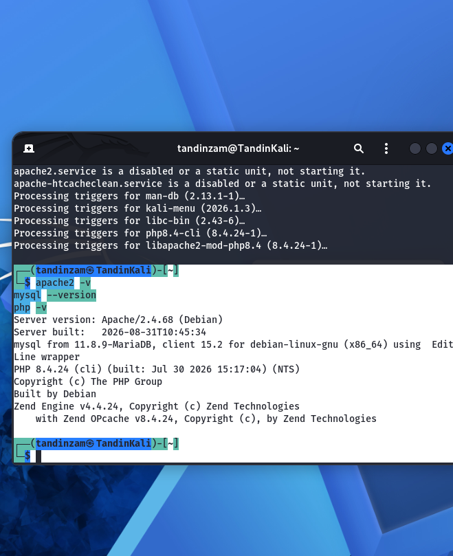

### Step 2: Start the web server and database

```bash
sudo systemctl start apache2
sudo systemctl start mariadb
```

Both services started with no errors.

### Step 3: Download DVWA into the web root

Apache serves files from the folder `/var/www/html`, so DVWA was cloned into that folder. The default Apache page was removed first.

```bash
cd /var/www/html
sudo rm -f index.html
sudo git clone https://github.com/digininja/DVWA.git .
```

The clone finished successfully, downloading 5840 objects.

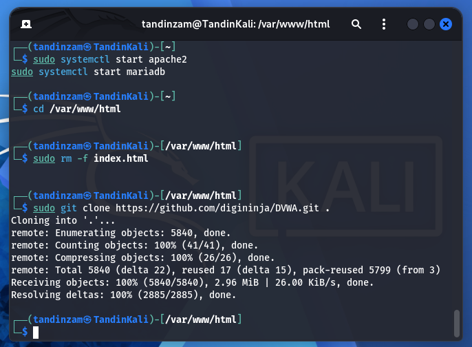

### Step 4: Create the configuration file

DVWA comes with a sample config file that was copied into the real config file. The default values inside it (database user `dvwa` and password `p@ssw0rd`) were kept, so no editing was needed.

```bash
cd /var/www/html/config
sudo cp config.inc.php.dist config.inc.php
```

### Step 5: Create the database and database user

The database and a matching user were created inside MariaDB so DVWA would have somewhere to store its data.

```bash
sudo mariadb
```

Then inside the MariaDB shell:

```sql
CREATE DATABASE dvwa;
CREATE USER 'dvwa'@'localhost' IDENTIFIED BY 'p@ssw0rd';
GRANT ALL PRIVILEGES ON dvwa.* TO 'dvwa'@'localhost';
FLUSH PRIVILEGES;
EXIT;
```

Each line returned `Query OK`, which confirmed the database and user were created.

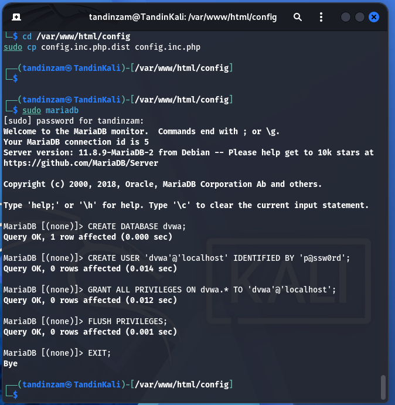

### Step 6: Enable allow_url_include in PHP

DVWA asks for one PHP setting to be turned on. The PHP config file was opened and the setting was changed from Off to On.

```bash
sudo nano /etc/php/8.4/apache2/php.ini
```

Changed `allow_url_include = Off` to `allow_url_include = On`, then restarted Apache so the change took effect:

```bash
sudo systemctl restart apache2
```

### Step 7: Fix folder permissions

The DVWA setup page needs two folders to be writable. Their permissions were updated.

```bash
sudo chmod -R 777 /var/www/html/hackable/uploads/
sudo chmod -R 777 /var/www/html/config/
```

### Step 8: Run the DVWA setup page

In the browser, `http://127.0.0.1/setup.php` was opened. This page runs a checklist to confirm everything is ready. Before fixing the folder permissions, the two "Writable folder" checks showed red (No).

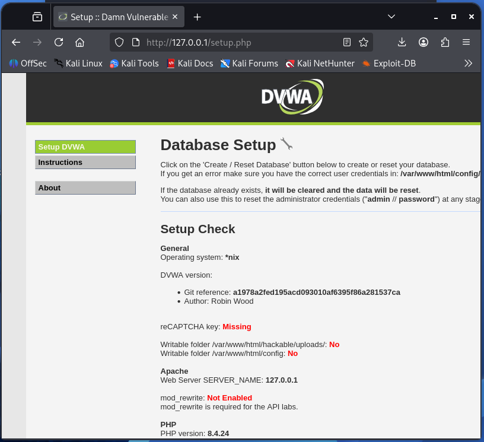

After the folder permission fix, the two "Writable folder" checks and the `allow_url_include` check all showed green. A few red items remained (reCAPTCHA key, mod_rewrite, and the API vendor files) but these are only needed for other labs, not for this scan, so they were safely ignored.

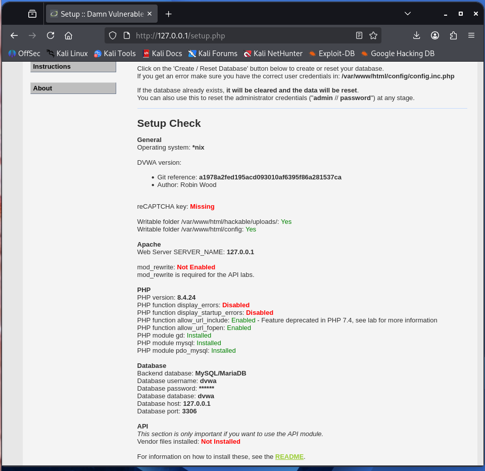

The **Create / Reset Database** button at the bottom was clicked. The page then reported that the database and all its tables were created.

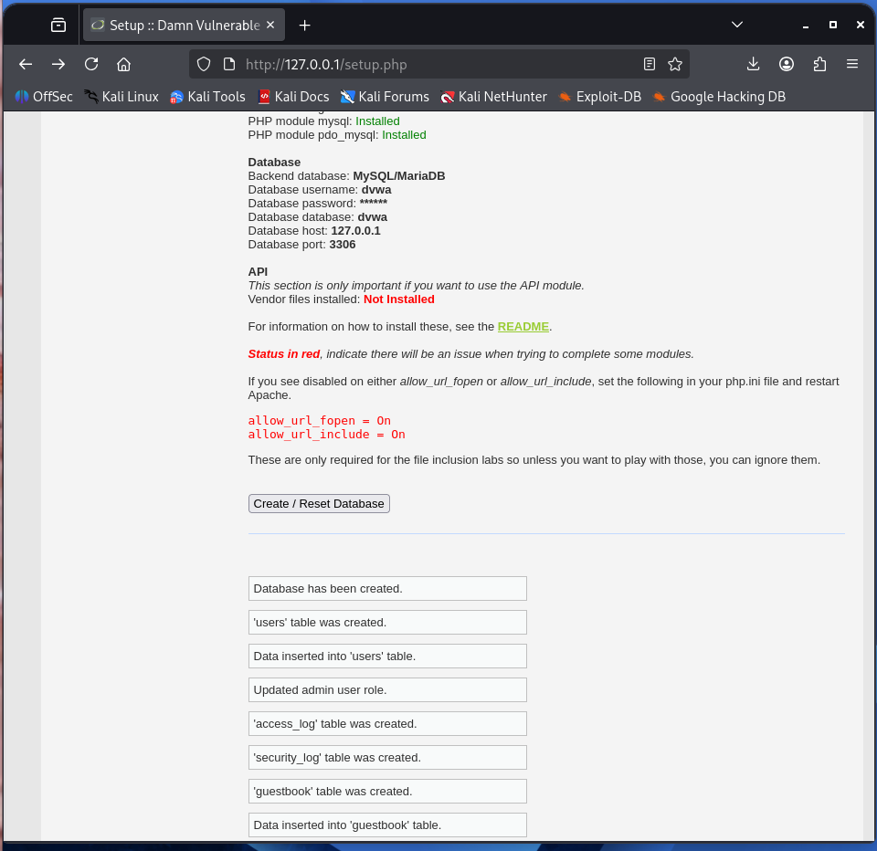

### Step 9: Log in to DVWA

The login page appeared, and login was done using the default credentials `admin` / `password`.

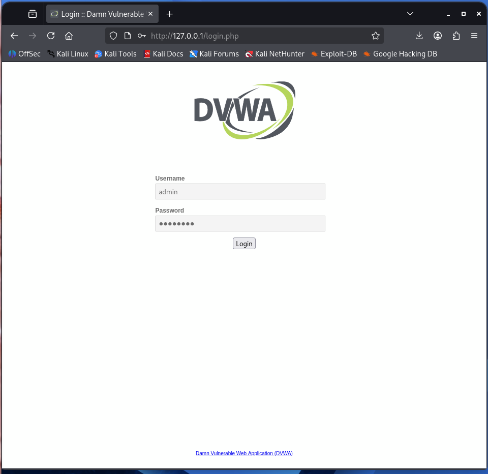

This opened the main DVWA welcome page with the list of vulnerability labs on the left.

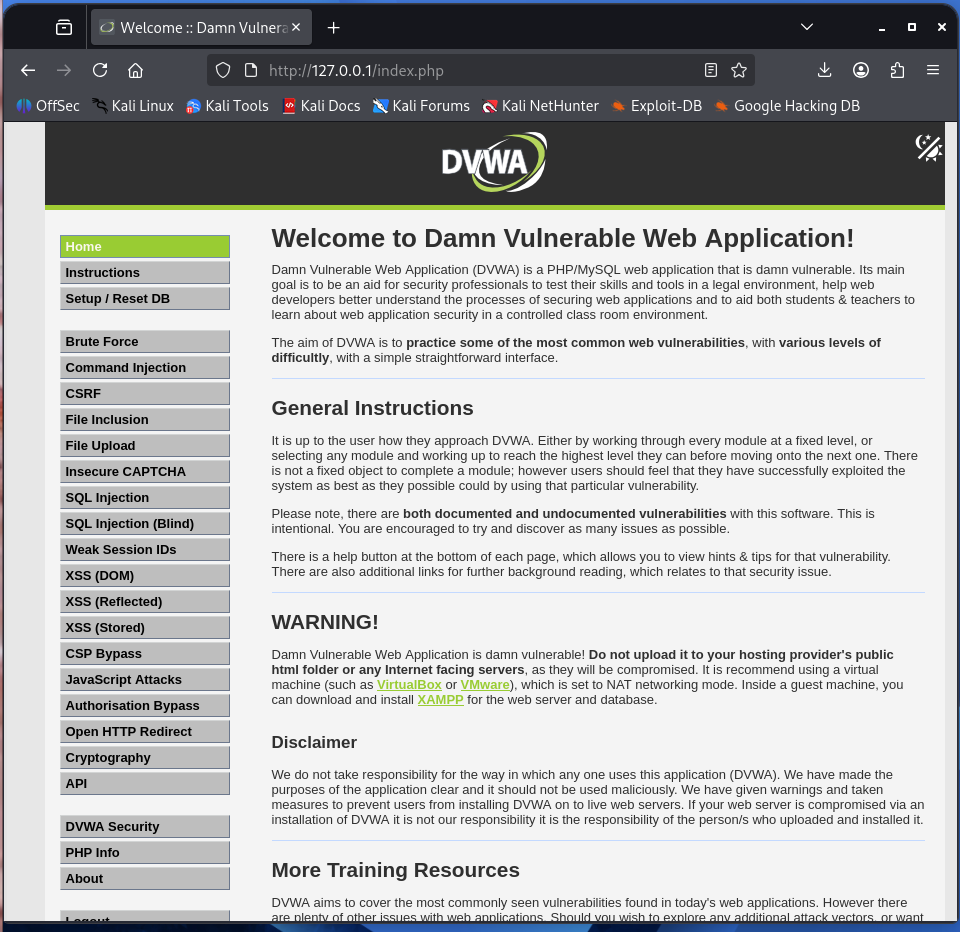

### Step 10: Set the security level to Low

In the **DVWA Security** tab, the security level was set to **Low** and submitted. The page confirmed "Security level set to low". Low means the application's intentional vulnerabilities are fully exposed, which is the standard setting for this kind of exercise.

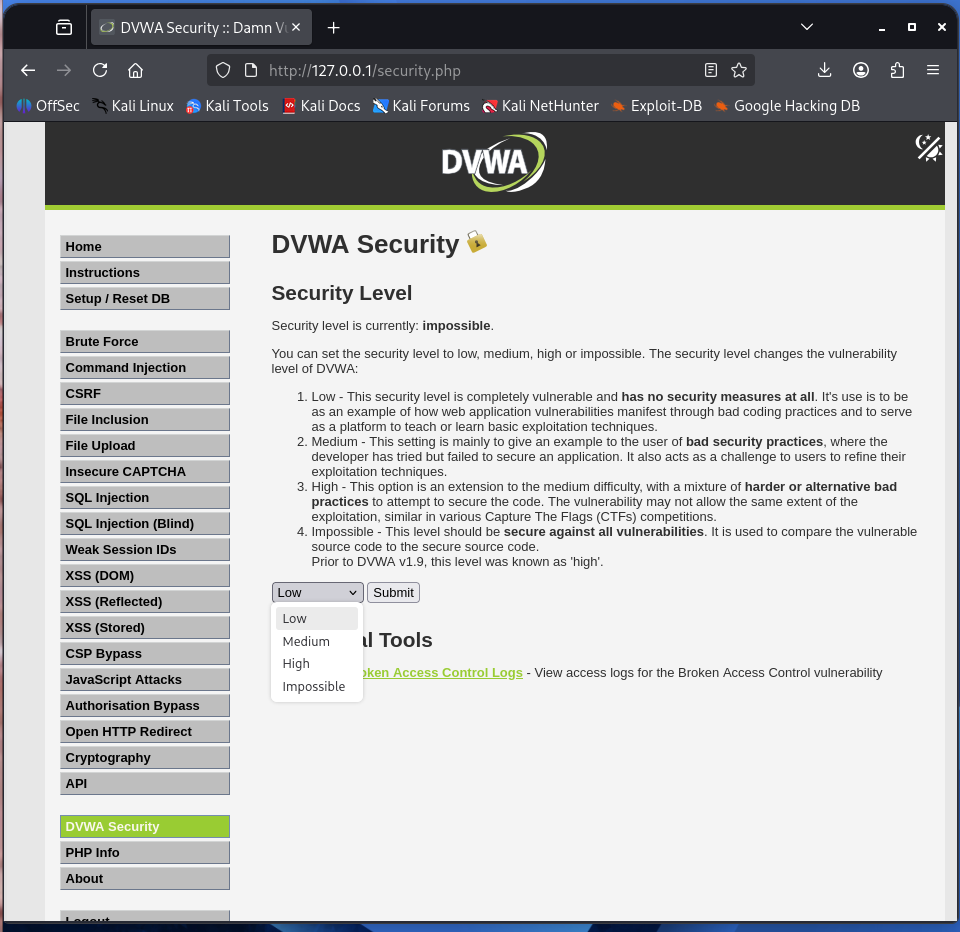

## 5. Scan Execution

### Step 1: Confirm Nikto is installed

```bash
nikto -Version
```

This confirmed Nikto v2.6.0 was already available on Kali.

### Step 2: Run the scan

Nikto was pointed at the local DVWA site. The `-o` flag saves the results to a file, and `-Format htm` saves that file as a web page, which is easier to read later.

```bash
nikto -h http://127.0.0.1 -o nikto_dvwa.html -Format htm
```

The scan ran for 348 seconds (just under 6 minutes), sent 8040 requests, and reported 21 items of interest.

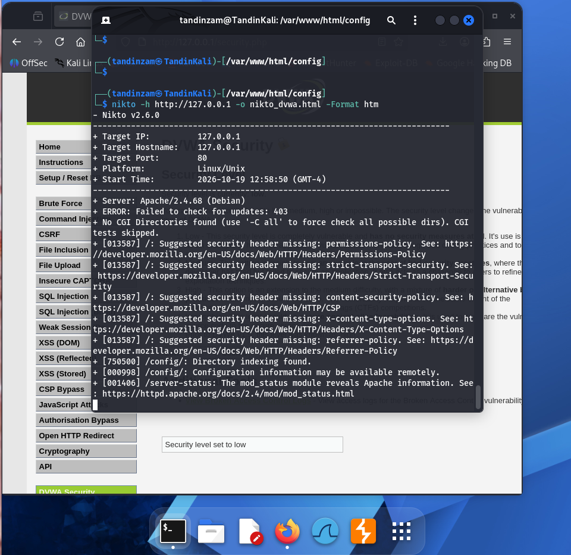

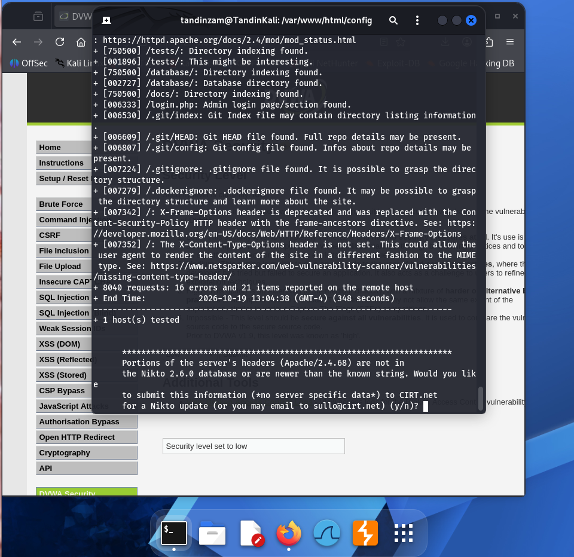

At the very end, Nikto asked whether to submit the server header to its online database, because the Apache version found was newer than the version stored in Nikto's own list. This was answered with `n` (no), since there was no need to submit anything. This also showed that the Apache version on this machine is up to date.

---

## 6. Findings and Interpretation

| # | Finding | What It Means | Risk Level | Recommended Fix |
|---|---|---|---|---|
| 1 | `Server: Apache/2.4.68 (Debian)` | The web server tells everyone its exact name and version in its response headers. | Medium | Set `ServerTokens Prod` and `ServerSignature Off` in Apache config to hide the version. |
| 2 | 5 security headers missing (Content-Security-Policy, X-Content-Type-Options, Strict-Transport-Security, Referrer-Policy, Permissions-Policy) | These headers tell the browser how to behave safely. Without them the site is more open to attacks like clickjacking, MIME-sniffing, and data leakage. | Medium | Add these headers to the server responses in the Apache configuration. |
| 3 | `X-Content-Type-Options` header not set | The browser may guess the type of a file instead of trusting what the server says, which can be abused in some attacks. | Low-Medium | Add the header `X-Content-Type-Options: nosniff`. |
| 4 | `/config/` directory indexing enabled | Anyone can open this folder in a browser and see its file list. | High | Turn off directory listing with `Options -Indexes` in Apache. |
| 5 | `/config/` configuration information may be exposed | The config folder can contain database passwords and secrets, so exposing it is dangerous. | Critical | Move sensitive config files outside the public web folder, or block access to them. |
| 6 | `/server-status` reveals Apache information | This page shows live details about the Apache server, which helps an attacker understand the system. | Medium | Disable the mod_status page or restrict it to localhost only. |
| 7 | `/tests/` directory indexing enabled | Internal test files are left visible to the public. | Medium | Turn off directory listing and remove test files from the live server. |
| 8 | `/database/` directory indexing enabled / database directory found | The database folder is browsable, which could reveal schema files or backups. | High | Turn off indexing and keep database files outside the public web folder. |
| 9 | `/docs/` directory indexing enabled | Internal documentation is publicly browsable. | Low-Medium | Turn off indexing or remove the docs folder from the live server. |
| 10 | `/login.php` admin login page found | Confirms where the login page is. | Informational | Not a vulnerability on its own, but useful to an attacker trying to guess passwords. Rate-limiting and account lockout help here. |
| 11 | `.git/index`, `.git/HEAD`, `.git/config` exposed | The whole Git version history of the app is downloadable, which can include source code and old secrets. | Critical | Never put the `.git` folder on a live server. Block access to hidden dotfiles in Apache. |
| 12 | `.gitignore` exposed | Shows which files the developer chose to hide, giving an attacker a map of files to look for. | Low | Block access to hidden files in the public web folder. |
| 13 | `.dockerignore` exposed | Reveals details about the Docker build and deployment setup. | Low | Same fix as above, restrict access to hidden dotfiles. |

---

## 7. Risk Summary

| Risk Level | Count | Findings |
|---|---|---|
| Critical | 2 | Exposed `.git` repository, exposed `/config/` directory contents |
| High | 2 | `/config/` indexing, `/database/` indexing |
| Medium | 4 | Apache version disclosure, `/server-status` exposure, `/tests/` indexing, missing security headers (combined) |
| Low | 3 | `/docs/` indexing, `.gitignore` exposure, `.dockerignore` exposure |
| Informational | 1 | Login page location disclosed |

---

## 8. Conclusion

This assessment shows how a default or development-style setup, like this DVWA installation, can leak sensitive internal files, folder listings, and server details to anyone who scans it, even without using a single real attack such as SQL Injection or XSS. All of the findings came from simple misconfigurations and leftover development files, not from clever hacking.

The three most important things to fix, in order of seriousness, would be:

1. **Remove the exposed `.git` folder.** This is the most serious finding, because it could let an attacker download the full source code and history of the application, possibly including passwords committed earlier.
2. **Turn off directory listing on `/config/`, `/database/`, `/tests/`, and `/docs/`.** These folders should never be browsable, since they can reveal credentials, database details, and internal logic.
3. **Hide the server version and add the missing security headers.** This makes it harder for an attacker to learn about the system and closes off some common browser-based attacks.

One thing worth noting is that the Apache version on this machine was actually up to date, which is why Nikto did not flag it as outdated. That is a good result, and it shows the value of keeping server software patched.

Overall, this exercise showed how useful a simple scanner like Nikto is as a first step, and how most web server risk often comes from basic mistakes like leaving development files and open folders on a live server.

---

## 9. Tools Used

- **Nikto v2.6.0** — web server vulnerability scanner, the main tool for this assignment.
- **Kali Linux** — the operating system used, which comes with many security tools pre-installed.
- **Apache 2.4.68** — the web server that hosts the DVWA application.
- **MariaDB 11.8.9** — the database that stores DVWA's data.
- **PHP 8.4.24** — the language DVWA is written in.
- **DVWA (Damn Vulnerable Web Application)** — the intentionally vulnerable target that was scanned.
- **Oracle VirtualBox** — the software used to run Kali Linux as a virtual machine.
